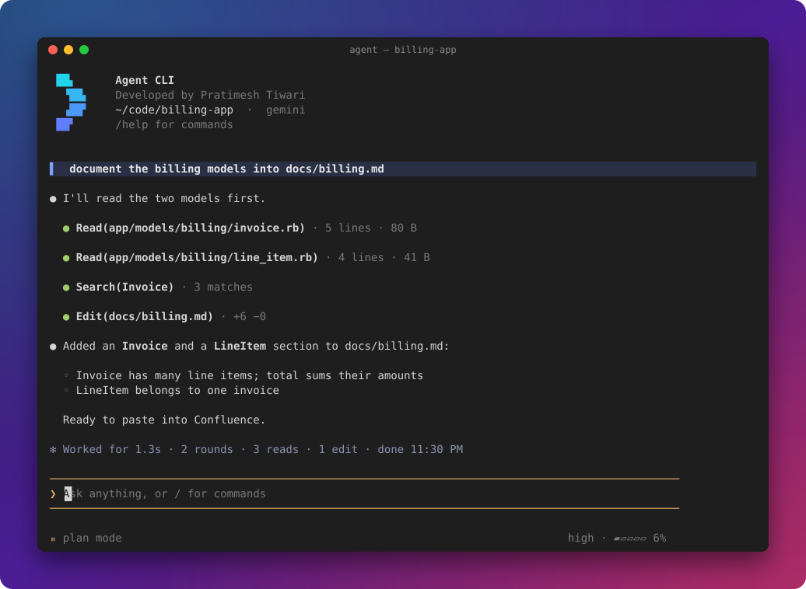
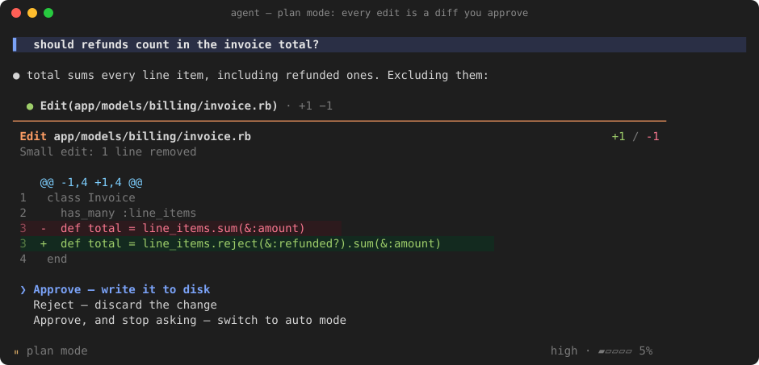
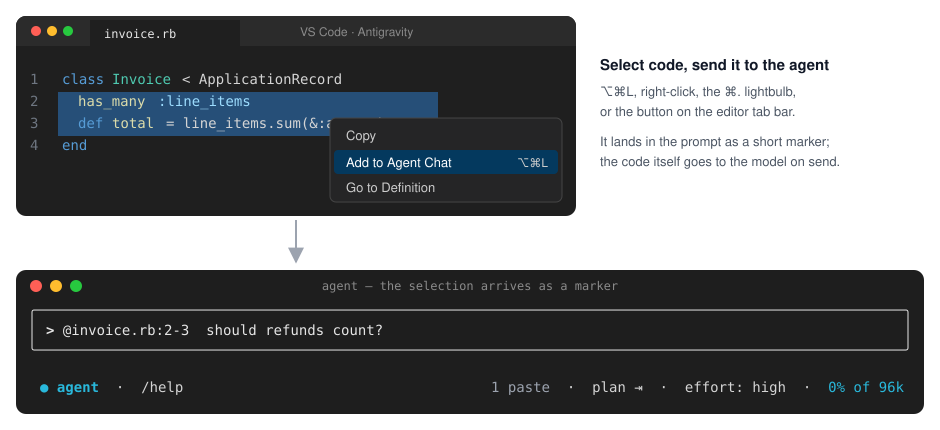
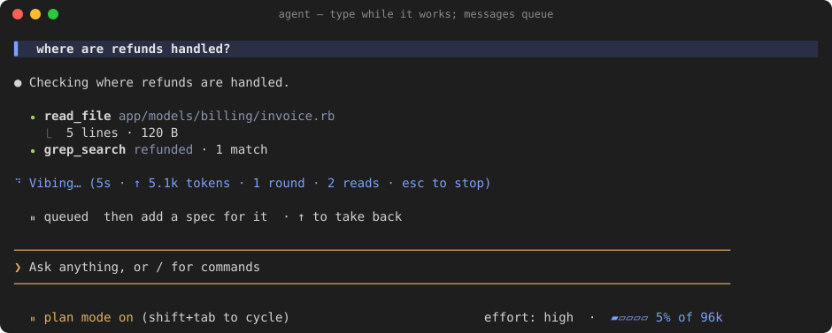
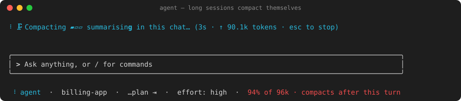
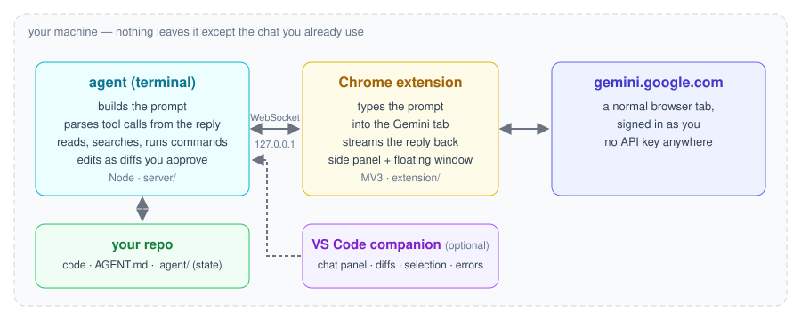
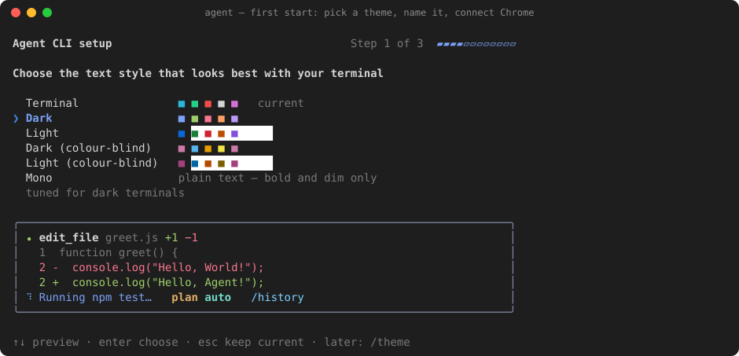

# Agent CLI

A coding agent for your terminal, in the style of Claude Code — with **no API key**. It drives a
Gemini tab in your own Chrome, signed in as you: the agent writes the prompt, a small extension
types it in and streams the reply back, and the agent reads, edits and runs things in your repo.



- **Local.** No hosted backend, no telemetry, no keys. Nothing leaves your machine except the chat
  you already use.
- **You stay in control.** Edits are diffs you approve (or not, in auto mode), commands are
  risk-checked, and every shell command is logged.
- **Built for real repos.** Large files, long sessions that compact themselves, background tasks,
  and an editor panel for VS Code.

## A quick tour

**Every edit is a diff you approve** — in plan mode, the change is shown before anything is
written. Approve, reject, or approve and switch to auto mode.



**Send code from your editor** — with the VS Code companion, select lines and press `⌥⌘L`.



**Keep typing while it works** — new messages queue and go out when the turn ends; `↑` takes one
back.



**Long sessions look after themselves** — near the limit the agent summarises the conversation in
the same chat, moves to a fresh one, and carries on: one line in the transcript, the summary behind
`ctrl+e`. The status bar's meter warns you first (`▰▰▰▰▱ 72% · compacts at 80%`).



*Screenshots are real terminal frames from the project's test harness, replayed through a terminal
emulator; the editor in the second one is an illustration.*

## How it works



The agent and the extension talk over a WebSocket on `127.0.0.1`. There is no tool-call API — the
agent reads tool calls out of Gemini's reply text, runs them, and sends the results back as the next
message. One Gemini tab holds the conversation; subagents get tabs of their own.

## Install

You need **Node.js 20+**, **Google Chrome**, and a **signed-in tab on [gemini.google.com](https://gemini.google.com)**.

```bash
curl -fsSL https://raw.githubusercontent.com/PratimeshTiwari/Agent-CLI/main/setup.sh | bash
```

That clones to `~/Agent-CLI`, installs, runs the tests, and puts `agent` (and `agent-cli`) on your
`PATH`. Re-running it updates. Prefer to read it first? [`setup.sh`](setup.sh), or:

```bash
git clone https://github.com/PratimeshTiwari/Agent-CLI.git && cd Agent-CLI && ./setup.sh
```

Then two things no installer can do for you:

1. **Load the Chrome extension.** `chrome://extensions` → turn on **Developer mode** → **Load
   unpacked** → pick the `extension/` folder. Pin **Agent CLI Bridge**.
2. **Open gemini.google.com and sign in.** Leave the tab open.

**Optional — the VS Code companion.** Extensions panel → `…` → **Install from VSIX…** →
`vscode-companion/cli-agent-companion-1.8.2.vsix`. It gives the agent your open file, cursor and
Problems panel, and adds a chat panel to the sidebar (`cmd+alt+j`).

## First run

```bash
cd ~/code/your-project
agent
```



The very first start walks you through setup, one screen per step: pick a theme (previewed live
as you move), name the agent (the banner previewed as you type), and connect Chrome (the exact folder
to load, and a spinner that turns into **Connected** when the extension dials in). Enter goes on,
esc skips. Later: `/theme` and `/name`.

The status line shows the mode — `⏸ plan mode on (shift+tab to cycle)` — and the input box says so if
the extension is not connected. Type a request and press Enter. To pick up where you left off:
`agent --continue`, or `agent --resume <id>` (printed under the transcript when you exit).

## Using it

### Modes — `shift+tab` cycles them

The status line says which one is on, the way Claude Code does: `⏸ plan mode on`,
`⏵⏵ auto mode on`, `⏹ strict plan mode on`. The rules above and below the input take the mode's colour.

| Mode | Edits | Commands |
| --- | --- | --- |
| **plan** (default) | ask first — except Markdown inside the repo, which is written straight away (AGENT.md and CLAUDE.md still ask) | ask first, unless read-only |
| **auto** | small, safe edits apply on their own; large rewrites ask | safe ones run, risky ones ask |
| **strict** | every edit asks, Markdown included | ask first, unless read-only |

### Keys

| Key | |
| --- | --- |
| `esc` | stop the run |
| `ctrl+c` twice | quit (prints how to resume) |
| `↑` | with an empty prompt, take back a queued message |
| `ctrl+x` `ctrl+s` | steer the last queued message into the running turn instead of waiting |
| `ctrl+e` | expand or collapse every step |
| `ctrl+o` | show or hide the task list |
| `ctrl+b` | bring the Gemini tab to the front |
| `ctrl+j` | newline without sending |
| `⌘⇧1` | the floating chat window, from any app *(bind it once at `chrome://extensions/shortcuts`, Global)* |

**Themes.** `/theme` picks the colours and previews each as you move through the list: Dark and
Light (tuned palettes), colour-blind versions of both (blue and orange instead of green and red),
**Terminal** (your terminal's own colours, the default) and Mono. The choice follows you across
repos (`~/.agent/settings.json`); `NO_COLOR` always means Mono.

Messages typed while the agent is working are **queued** and sent when it finishes. Paste freely —
long pastes collapse to a marker. `/image` attaches an image (bare for the clipboard).

### Commands worth knowing

| Command | |
| --- | --- |
| `/effort low·medium·high` | how hard to work; switches the Gemini model picker to match |
| `/diff` | the last edit's diff, and whether it was written |
| `/undo` | revert the last edit |
| `/copy` | the last reply, as markdown, to the clipboard — `/copy code` for the last code block |
| `/shell` | a scratch shell, one command, then back to the prompt |
| `/compact` | summarise the conversation now (it also happens on its own, with a progress bar) |
| `/history` | past conversations — pick one to reopen |
| `/settings` | everything that is set, on one page |
| `/theme` | colours — Dark, Light, colour-blind, Terminal (the classic look) or Mono; previews as you move |
| `/logs` | what has been failing · `/logs extension` for how long the browser takes |
| `/reset` | start this repo fresh — its `.agent` state goes to `~/.agent/trash`, nothing deleted |
| `/help` | every key and command |

## Telling it about your project

- **`AGENT.md`** at the root of your code: conventions it must know before its first edit ("tests
  run with `pnpm vitest`", "never edit `src/generated/`"). Nested ones are read too, nearest wins;
  `~/.agent/AGENT.md` applies everywhere.
- **Skills** — Markdown files in `.agent/skills/` that it opens only when their one-line
  description matches the task. `/skills` lists and creates them.
- **Memory** — facts it learns along the way, in `.agent/memory.md`. `/memory` shows them; edit the
  file to correct one.

## Where it keeps things

Everything for a repo lives in **`<repo>/.agent/`** — config, sessions, logs, backups for `/undo`,
and `artifacts/` (task list, plans) written for you to read. A second copy of the conversation
history lives in `~/.agent/workspaces/` so a fresh checkout doesn't lose it. In a monorepo, one
`.agent/` at the top holds a folder per repo.

## Troubleshooting

| You see | Do |
| --- | --- |
| `○ agent` in yellow | The extension isn't connected: open a gemini.google.com tab, or reload the extension at `chrome://extensions` |
| ⌘⇧1 does nothing | Chrome only assigns the shortcut on first install — set it at `chrome://extensions/shortcuts` and choose **Global** |
| It feels slow | `/logs extension` shows each stage of a turn; typing the prompt should take well under a second |
| Something failed | `/logs` groups failures by where they came from |
| After `git pull` | `/update` says what to reload — usually the extension and a restart |

## Release history

Every change reached `main` through a pull request from a branch that is kept. The full list — every
PR with its date, branch and notes — is in [`CHANGELOG.md`](CHANGELOG.md).

| Series | Dates | PRs | What it was about |
| --- | --- | --- | --- |
| **v5** | 2026-10-19 … 2026-10-25 | [#63](https://github.com/PratimeshTiwari/Agent-CLI/pull/63)–[#84](https://github.com/PratimeshTiwari/Agent-CLI/pull/84) | Clean slate, one recovery policy, the VS Code chat panel, compaction that hands over, large files, three modes, themes, and a redesigned transcript |
| **v4** | 2026-09-27 … 2026-10-19 | [#60](https://github.com/PratimeshTiwari/Agent-CLI/pull/60)–[#62](https://github.com/PratimeshTiwari/Agent-CLI/pull/62) | An honest failure log, the rename to Agent CLI, fixes from real use |
| **v3** | 2026-09-22 … 2026-09-27 | [#26](https://github.com/PratimeshTiwari/Agent-CLI/pull/26)–[#59](https://github.com/PratimeshTiwari/Agent-CLI/pull/59) | The model picker, tab lanes, effort low/medium/high, traces, subagent fixes |
| **v2** | 2026-09-20 … 2026-09-22 | [#17](https://github.com/PratimeshTiwari/Agent-CLI/pull/17)–[#25](https://github.com/PratimeshTiwari/Agent-CLI/pull/25) | Bridge speed and stability, tool-call parsing and discipline, prompt trims |
| **v1** | 2026-09-16 | [#13](https://github.com/PratimeshTiwari/Agent-CLI/pull/13)–[#16](https://github.com/PratimeshTiwari/Agent-CLI/pull/16) | The first stable release |
| **Betas** | 2026-08-26 … 2026-09-06 | [#1](https://github.com/PratimeshTiwari/Agent-CLI/pull/1)–[#12](https://github.com/PratimeshTiwari/Agent-CLI/pull/12) | Context management, subagents, the GitHub agent (later removed), the CLI |

## More

- [`CHANGELOG.md`](CHANGELOG.md) — what changed, release by release
- [`CLAUDE.md`](CLAUDE.md) — architecture, internals, and why things are the way they are
- [`extension/README.md`](extension/README.md) · [`vscode-companion/README.md`](vscode-companion/README.md)

Developed by Pratimesh Tiwari.
