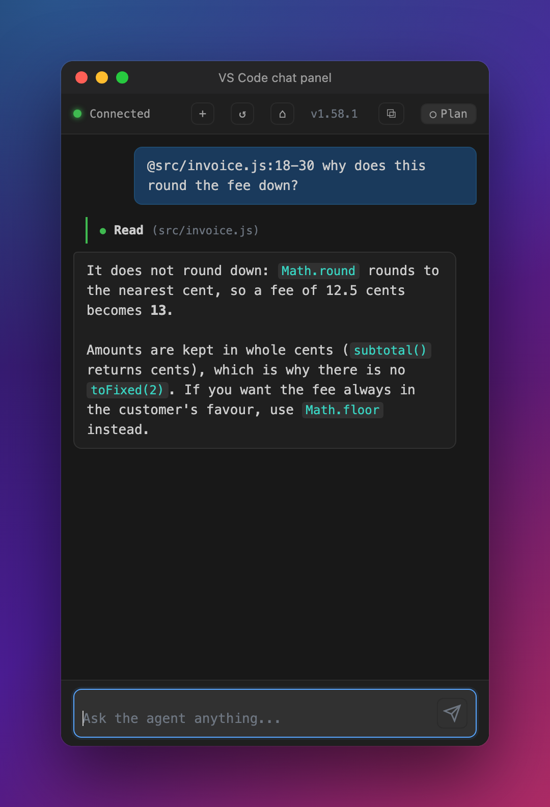

# Agent CLI

A coding agent for your terminal, in the style of Claude Code, with **no API key**. It works
through a Gemini tab in your own Chrome, signed in as you: the agent writes the prompt, a small
extension types it in and streams the reply back, and the agent reads, edits and runs things in your
repo.


- **Local.** No hosted backend, no telemetry, no keys. Nothing leaves your machine except the chat
  you already use.
- **You stay in control.** Every edit is a diff you approve, commands are risk-checked, and every
  shell command is logged.
- **Built for real repos.** Large files, long sessions that compact themselves, logs and documents,
  symbols in 16 languages, Jira, and a chat panel in Chrome and VS Code.

## See it work

| | |
| --- | --- |
| <br>**Every edit is a diff** you approve first | <br>**Keep typing**: messages queue during a turn |
| <br>**Long sessions** summarise and carry on | <br>**`/settings`**: switches, changed with `←/→` |
| <br>**`/effort`**: faster to smarter, on a slider | <br>**Browser on another model?** It asks first |
| <br>**Pro at its limit**: steps down and says so | <br>**Documents**: a PDF read as Markdown |
| <br>**`/doctor`**: every package, installed and latest | <br>**`/doctor <package>`**: why it is used |
| <br>**First start**: theme, name, Chrome | <br>**From VS Code**: send a selection with `⌥⌘L` |

The same conversation, outside the terminal:

| | | |
| --- | --- | --- |
| <br>**Chrome side panel** | <br>**Floating window**, `⌘⇧1` from any app | <br>**VS Code chat panel**, `⌥⌘J` |

## How it works


1. You type a request. The agent builds a prompt from it, your project's `AGENT.md` and the tools
   it can call.
2. It sends the prompt over a local WebSocket to the Chrome extension, which types it into your
   Gemini tab and streams the reply back.
3. There is no tool-call API, so the agent reads tool calls out of the reply text: read a file,
   search, edit, run a command.
4. It runs them (edits and risky commands ask you first) and sends the results back as the next
   message, until the reply has no more calls.

Subagents get tabs of their own. The full design, and the reasons behind it, are in
[`CLAUDE.md`](CLAUDE.md), under **Architecture**.

## Install

You need **Node.js 20+**, **Google Chrome**, and a **signed-in tab on [gemini.google.com](https://gemini.google.com)**.

```bash
curl -fsSL https://raw.githubusercontent.com/PratimeshTiwari/Agent-CLI/main/setup.sh | bash
```

That clones to `~/Agent-CLI`, installs, runs the tests, and puts `agent` (and `agent-cli`) on your
`PATH`. Re-running it updates. To read it first: [`setup.sh`](setup.sh), or
`git clone https://github.com/PratimeshTiwari/Agent-CLI.git && cd Agent-CLI && ./setup.sh`.

Then two things no installer can do for you:

1. **Load the Chrome extension.** `chrome://extensions` → turn on **Developer mode** → **Load
   unpacked** → pick the `extension/` folder. Pin **Agent CLI Bridge**.
2. **Open gemini.google.com and sign in.** Leave the tab open.

**Optional: the VS Code companion** (VS Code, Cursor, Antigravity, Windsurf) gives the agent your
open file, cursor and Problems panel, and adds the chat panel and **Attach to Agent CLI**:

```bash
code --install-extension ~/Agent-CLI/vscode-companion/cli-agent-companion-1.8.9.vsix
```

Other editors, other install folders and Antigravity IDE are covered in
[`vscode-companion/README.md`](vscode-companion/README.md#installing).

## First run

```bash
cd ~/code/your-project
agent
```

The first start walks through setup: a theme (previewed live), the agent's name, and connecting
Chrome. Then type a request and press Enter. When you quit, it prints the command that resumes the
conversation.

## Commands in your shell

| Command | |
| --- | --- |
| `agent` | start in this folder |
| `agent --continue` · `agent --resume <id>` | carry on the last conversation, or a given one |
| `agent --sessions` | list past conversations here |
| `agent -w <path>` | work on another folder |
| `agent doctor` | what is installed, what is missing, what is out of date; works even when the agent cannot start |
| `agent doctor <package>` | why a package is used, and what breaks without it |
| `agent doctor --test` | run the agent's own tests, to check this install |
| `agent atlassian login` · `status` · `logout` | sign in to Jira; the token goes to the Keychain |
| `agent --help` | all of the above, and every option |

## Inside the agent

### Modes: `shift+tab` cycles them

| Mode | Edits | Commands |
| --- | --- | --- |
| **plan** (default) | ask first, except Markdown inside the repo (AGENT.md and CLAUDE.md still ask) | ask first, unless read-only |
| **auto** | small, safe edits apply on their own; large rewrites ask | safe ones run, risky ones ask |
| **strict** | every edit asks, Markdown included | ask first, unless read-only |

### Keys

| Key | |
| --- | --- |
| `esc` | stop the run |
| `ctrl+c` twice | quit (prints how to resume) |
| `?` | every key, on one screen |
| `↑` `↓` | move between the prompt's rows; past the first or last, earlier prompts |
| `↑` | with an empty prompt, take back a queued message |
| `ctrl+x` `ctrl+s` | steer the last queued message into the running turn |
| `ctrl+e` | expand or collapse every step |
| `ctrl+o` | show or hide the task list |
| `ctrl+b` | bring the Gemini tab to the front |
| `shift+enter` · `ctrl+n` | a newline without sending (`shift+enter` where the terminal reports it, and in editors with the companion) |
| `ctrl+v` | attach an image from the clipboard as `[Image #1]` |
| `⌘⇧1` | the floating chat window, from any app *(bind it once at `chrome://extensions/shortcuts`, Global)* |

### Commands

| Command | |
| --- | --- |
| `/effort` | how hard to work, on a slider; switches the Gemini model to match |
| `/settings` | everything that is set, on one page |
| `/prompt` | which prompt version is sent: `v1` (the default, frozen) to `v4` (adds Jira); bare `/prompt` compares them |
| `/chat <link or id>` | continue this session in another Gemini chat |
| `/doctor` | packages and tools: install, update, pick a version, remove unused |
| `/diff` · `/undo` | the last edit, and reverting it |
| `/copy` | the last reply as Markdown · `/copy code` for the last code block |
| `/shell` | one shell command, then back to the prompt |
| `/compact` | summarise now (it also offers to when the chat is nearly full) |
| `/history` | past conversations; pick one to reopen |
| `/context` | what is in the window and which files feed the prompt |
| `/subagents on·off` | parallel tabs for research and review |
| `/theme` | Dark, Light, colour-blind, Terminal (the default) or Mono |
| `/logs` | failures, speed, tool use and notices |
| `/jira` | check the Jira sign-in |
| `/reset` | start this repo fresh; its `.agent` state goes to `~/.agent/trash` |
| `/help` | every key and command |

Drop a file or folder on the terminal and it becomes a `[File #1: app.js]` tag: only the path goes to
the model, which reads what it needs.

## What it can do

- **Edit safely.** Plan mode shows every edit as a diff first. Commands are risk-checked: read-only
  ones run, risky ones ask, anything aimed at production is refused. `/commands` lists every one.
- **Read code.** `find_symbol` and `find_references` in JavaScript, TypeScript, Ruby, Python, Go,
  Java, C/C++ and nine more, measured at 98–99.9% against each language's own parser.
- **Read documents and logs.** PDF, Word and PowerPoint come back as Markdown. `query_log` reads
  Grafana, Loki and Datadog exports of any size (200 MB in about 4 s, prompt v2).
- **Handle big files.** With subagents on, a file over 1,200 lines comes back as a digest; a ranged
  read always gets the exact text.
- **Work with Jira** (prompt v4). Read, search, create, update, comment, move and attach, on Cloud and
  Server/DC. Every write is shown first as a Send / Don't send box, in every mode.
- **Match the model.** `/effort` picks low, medium, high or max and switches Gemini to match. If the
  tab is on another model it asks; if Pro is at its limit it resends one rung lower and says so.

## Telling it about your project

- **`AGENT.md`** at the root of your code: what it must know before its first edit ("tests run with
  `pnpm vitest`", "never edit `src/generated/`"). Nested ones are read too, nearest wins;
  `~/.agent/AGENT.md` applies everywhere.
- **Skills**: Markdown files in `.agent/skills/` that it opens only when their one-line description
  matches the task. `/skills` lists and creates them.
- **Memory**: facts it learns along the way, in `.agent/memory.md`. `/memory` shows them.

## Where it keeps things

- **`<repo>/.agent/`**: config, sessions, logs, backups for `/undo`, and `artifacts/` (task list,
  plans) for you to read.
- **`~/.agent/workspaces/`**: a second copy of each conversation, so a fresh checkout keeps it.
- **Monorepos**: one `.agent/` at the top, with a folder per repo.

[`docs/agent-folder.md`](docs/agent-folder.md) maps both folders and says what is safe to delete.

## Troubleshooting

| You see | Do |
| --- | --- |
| `○ agent` in yellow | The extension isn't connected: open a gemini.google.com tab, or reload the extension at `chrome://extensions` |
| ⌘⇧1 does nothing | Chrome assigns the shortcut only on first install. Set it at `chrome://extensions/shortcuts` and choose **Global** |
| It feels slow | `/logs speed` shows each stage of a turn |
| Something failed | `/logs` groups failures by where they came from |
| A feature fails on a new machine | `agent doctor` lists what is missing; `/doctor fix` installs it; `agent doctor --test` runs the tests |
| `latest` is blank in `/doctor` | npm could not reach your registry, and the reason is printed; on a work laptop check `npm config get registry` |
| A dropped PDF or image does nothing in Antigravity | Its agent panel takes those drops. Right-click the file → **Attach to Agent CLI**, or paste the path |
| After `git pull` | `/update` says what to reload, usually the extension and a restart |

## Release history

Every change reached `main` through a pull request from a branch that is kept. Each release, with its
date, branch and notes, is in [`docs/CHANGELOG.md`](docs/CHANGELOG.md).

| Series | Dates | PRs | Highlights |
| --- | --- | --- | --- |
| **v8** | 2026-10-31 … | [#142](https://github.com/PratimeshTiwari/Agent-CLI/pull/142)– | A silent reply is retried in a fresh tab; Jira, with every write approved; prompts always land in this session's chat; the server split into backend and frontend |
| **v7** | 2026-10-30 … 2026-10-31 | [#131](https://github.com/PratimeshTiwari/Agent-CLI/pull/131)–[#141](https://github.com/PratimeshTiwari/Agent-CLI/pull/141) | New docs and screenshots; faster typing between turns; formulas in replies; test and build commands detected; outlines on partial reads; a live token count |
| **v6** | 2026-10-30 | [#105](https://github.com/PratimeshTiwari/Agent-CLI/pull/105)–[#130](https://github.com/PratimeshTiwari/Agent-CLI/pull/130) | Settings that apply in place; Claude Code-style questions and action rows; a quieter status bar; large files and log exports; symbols in 16 languages; drag and drop |
| **v5** | 2026-10-19 … 2026-10-28 | [#63](https://github.com/PratimeshTiwari/Agent-CLI/pull/63)–[#101](https://github.com/PratimeshTiwari/Agent-CLI/pull/101) | The VS Code chat panel; three modes; themes; first-start setup; the effort slider; documents; `/doctor`; prompt versions |
| **v4** | 2026-09-27 … 2026-10-19 | [#60](https://github.com/PratimeshTiwari/Agent-CLI/pull/60)–[#62](https://github.com/PratimeshTiwari/Agent-CLI/pull/62) | A failure log you can trust; the rename to Agent CLI; fixes from real use |
| **v3** | 2026-09-22 … 2026-09-27 | [#26](https://github.com/PratimeshTiwari/Agent-CLI/pull/26)–[#59](https://github.com/PratimeshTiwari/Agent-CLI/pull/59) | The model picker; a tab per request; effort levels; turn traces |
| **v2** | 2026-09-20 … 2026-09-22 | [#17](https://github.com/PratimeshTiwari/Agent-CLI/pull/17)–[#25](https://github.com/PratimeshTiwari/Agent-CLI/pull/25) | A faster, steadier bridge; sturdier tool-call parsing; shorter prompts |
| **v1** | 2026-09-16 | [#13](https://github.com/PratimeshTiwari/Agent-CLI/pull/13)–[#16](https://github.com/PratimeshTiwari/Agent-CLI/pull/16) | The first stable release |
| **Betas** | 2026-08-26 … 2026-09-06 | [#1](https://github.com/PratimeshTiwari/Agent-CLI/pull/1)–[#12](https://github.com/PratimeshTiwari/Agent-CLI/pull/12) | Context management, subagents, the CLI |

## More

- [`docs/CHANGELOG.md`](docs/CHANGELOG.md): every release
- [`CLAUDE.md`](CLAUDE.md): architecture, internals, and why things are the way they are
- [`server/src/backend/README.md`](server/src/backend/README.md) · [`server/src/frontend/README.md`](server/src/frontend/README.md): what is where in the code, and how to debug it
- [`extension/README.md`](extension/README.md) · [`vscode-companion/README.md`](vscode-companion/README.md)

Developed by Pratimesh Tiwari.
