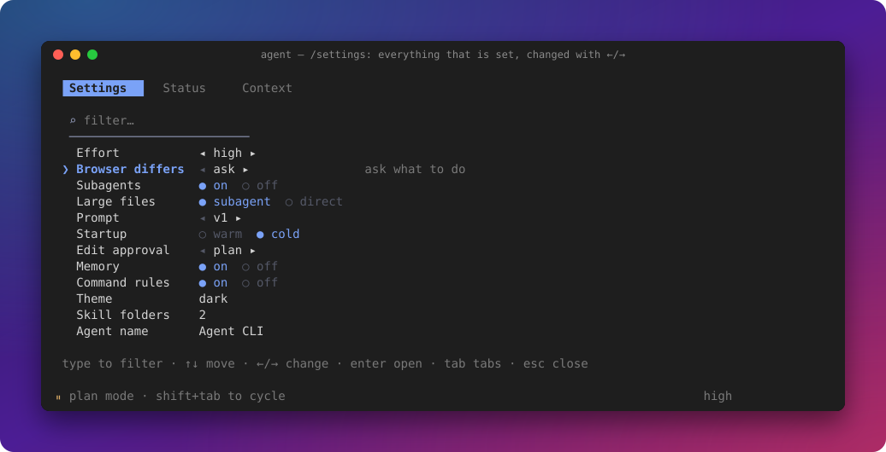
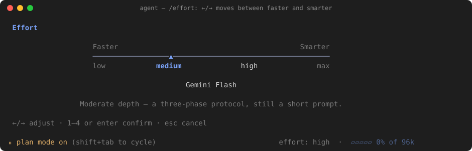
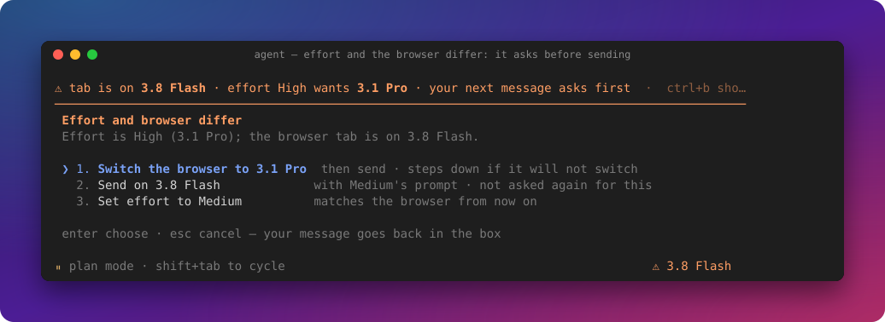
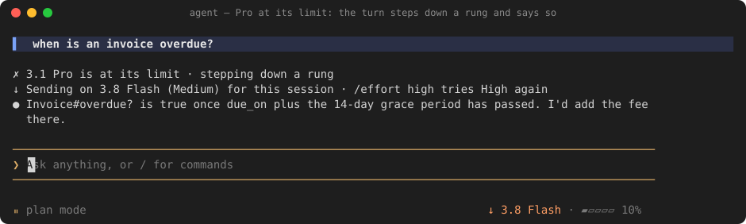
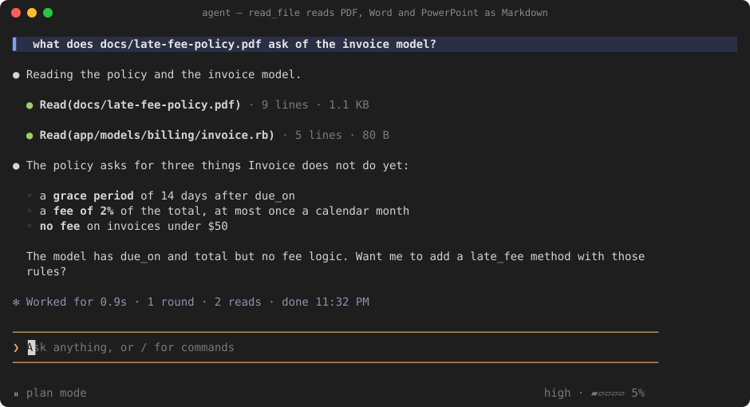
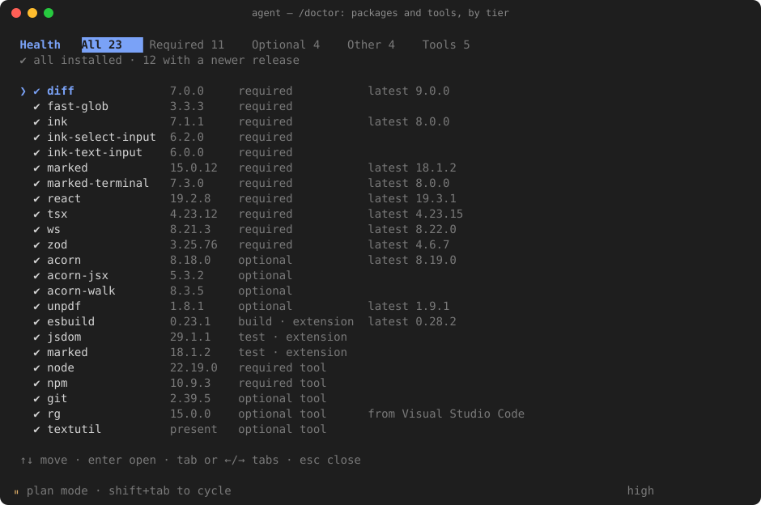
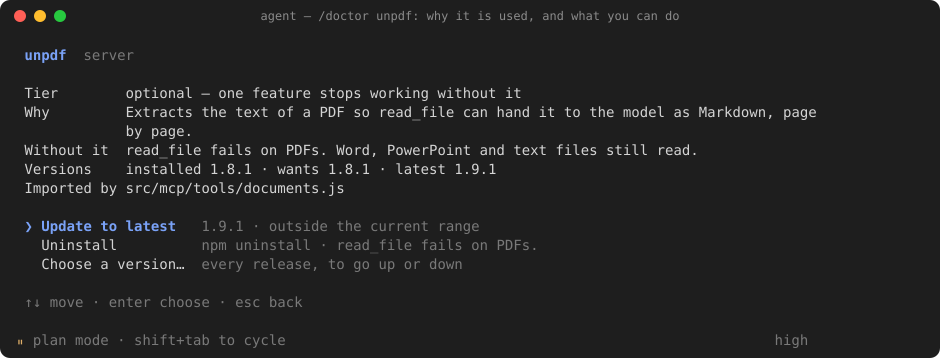

# Agent CLI

A coding agent for your terminal, in the style of Claude Code, with **no API key**. It drives a
Gemini tab in your own Chrome, signed in as you. The agent writes the prompt, a small extension
types it in and streams the reply back, and the agent reads, edits and runs things in your repo.

- **Local.** No hosted backend, no telemetry, no keys. Nothing leaves your machine except the chat
  you already use.
- **You stay in control.** Edits are diffs you approve, commands are risk-checked, and every shell
  command is logged.
- **Built for real repos.** Large files, long sessions that compact themselves, logs and documents,
  symbols in 16 languages, and a chat panel for VS Code.

## See it work

| | |
| --- | --- |
| <br>**At work**: reads two models, documents them | <br>**Every edit is a diff** you approve first |
| <br>**Keep typing**: messages queue during a turn | <br>**Long sessions** summarise and carry on |
| <br>**`/settings`**: switches, changed with `←/→` | <br>**`/effort`**: faster to smarter, on a slider |
| <br>**Browser on another model?** It asks first | <br>**Pro at its limit**: steps down and says so |
| <br>**Documents**: a PDF read as Markdown | <br>**From VS Code**: send a selection with `⌥⌘L` |
| <br>**`/doctor`**: every package, installed and latest | <br>**`/doctor <package>`**: why it is used |
| <br>**First start**: theme, name, Chrome | <br>**How it fits**: terminal, extension, Gemini tab |

*Real terminal frames from the project's test harness, replayed through a terminal emulator. The
editor in "From VS Code" and the architecture diagram are drawn.*

## What it does

**Editing, safely**
- Plan mode shows every edit as a diff first: approve, reject, or approve and switch to auto.
- Commands are risk-checked. Read-only ones run, risky ones ask, and anything aimed at production
  is refused. Every command is logged (`/commands`).
- `/undo` reverts the last edit; `/diff` shows it.

**Working with it**
- Messages typed during a turn queue up. `↑` takes one back; `ctrl+x ctrl+s` steers it into the
  running turn.
- Long pastes fold to a marker. `ctrl+v` attaches an image as `[Image #1]`. Dropped files and
  folders become `[File #1: app.js]` tags, and only the path goes to the model.
- Near the context limit it asks once: compact now (a summary, then a fresh chat) or carry on in
  this chat. `/compact` works any time.

**Reading code, documents and logs**
- `find_symbol` / `find_references` in JavaScript, TypeScript, Ruby, Python, Go, Java, C/C++ and
  nine more, measured at 98–99.9% of definitions against each language's own parser.
- `read_file` turns PDF, Word and PowerPoint into Markdown. With subagents on, a file over 1,200
  lines comes back as a digest; a ranged read always gets the exact text.
- `query_log` reads Grafana, Loki and Datadog exports of any size (200 MB in about 4 s): levels, a
  timeline, repeated errors, then filters (prompt v2).

**Models and effort**
- `/effort` picks low, medium, high or max and switches the Gemini model to match.
- If the tab is on a different model, it asks before sending. If Pro is at its limit, it resends
  one rung lower, once, and says so.

**Looking after the install**
- `/doctor` lists every package and tool by tier, with the installed and latest versions. It can
  install, update, pick a version or remove one, and undoes a change that stops the agent
  starting.
- `agent doctor` works from the shell even when the agent cannot start.

## How it works

The agent and the extension talk over a WebSocket on `127.0.0.1`. There is no tool-call API: the
agent reads tool calls out of Gemini's reply text, runs them, and sends the results back as the next
message. One Gemini tab holds the conversation, and subagents get tabs of their own. The full
design and the reasons behind it are in [`CLAUDE.md`](CLAUDE.md), under **Architecture**.

## Install

You need **Node.js 20+**, **Google Chrome**, and a **signed-in tab on [gemini.google.com](https://gemini.google.com)**.

```bash
curl -fsSL https://raw.githubusercontent.com/PratimeshTiwari/Agent-CLI/main/setup.sh | bash
```

That clones to `~/Agent-CLI`, installs, runs the tests, and puts `agent` (and `agent-cli`) on your
`PATH`. Re-running it updates. Prefer to read it first? [`setup.sh`](setup.sh), or:

```bash
git clone https://github.com/PratimeshTiwari/Agent-CLI.git && cd Agent-CLI && ./setup.sh
```

Then two things no installer can do for you:

1. **Load the Chrome extension.** `chrome://extensions` → turn on **Developer mode** → **Load
   unpacked** → pick the `extension/` folder. Pin **Agent CLI Bridge**.
2. **Open gemini.google.com and sign in.** Leave the tab open.

**Optional: the VS Code companion** (VS Code, Cursor, Antigravity, Windsurf). It gives the
agent your open file, cursor and Problems panel, adds a chat panel to the sidebar
(`cmd+alt+j`), and **Attach to Agent CLI** on the explorer's right-click menu. Extensions panel →
`…` → **Install from VSIX…** → `vscode-companion/cli-agent-companion-1.8.7.vsix`.

From a terminal, with your editor's command-line tool (`code`, `cursor`, `antigravity`,
`windsurf`; if it is not found, run **Shell Command: Install '…' command in PATH** from the
editor's command palette):

```bash
<editor> --install-extension <checkout>/vscode-companion/cli-agent-companion-1.8.7.vsix
```

`<checkout>` is wherever `setup.sh` put the agent. If you are not sure, the `agent` command
knows. This works for any install:

```bash
AGENT_HOME_DIR="$(sed -n 's|^exec node "\(.*\)/server/src/index.js".*|\1|p' "$(command -v agent)")"
code --install-extension "$AGENT_HOME_DIR"/vscode-companion/cli-agent-companion-1.8.7.vsix
```

Three common setups:

```bash
# setup.sh's default location, VS Code
code --install-extension ~/Agent-CLI/vscode-companion/cli-agent-companion-1.8.7.vsix

# a checkout from before the rename (setup.sh keeps it), Cursor
cursor --install-extension ~/Gemini-Agent/vscode-companion/cli-agent-companion-1.8.7.vsix

# a custom AGENT_INSTALL_DIR, Antigravity
antigravity --install-extension ~/Documents/Gemini-Agent/vscode-companion/cli-agent-companion-1.8.7.vsix
```

Then reload the window (**Developer: Reload Window**). Installing over an older version
replaces it.

## First run

```bash
cd ~/code/your-project
agent
```

- The first start walks through setup: a theme (previewed live), the agent's name, and connecting
  Chrome. Later: `/theme` and `/name`.
- Type a request and press Enter. The input box says so if the extension is not connected.
- To pick up where you left off: `agent --continue`, or `agent --resume <id>` (printed when you
  exit).

## Using it

### Modes: `shift+tab` cycles them

| Mode | Edits | Commands |
| --- | --- | --- |
| **plan** (default) | ask first, except Markdown inside the repo (AGENT.md and CLAUDE.md still ask) | ask first, unless read-only |
| **auto** | small, safe edits apply on their own; large rewrites ask | safe ones run, risky ones ask |
| **strict** | every edit asks, Markdown included | ask first, unless read-only |

### Keys

| Key | |
| --- | --- |
| `esc` | stop the run |
| `ctrl+c` twice | quit (prints how to resume) |
| `?` | every key, on one screen |
| `↑` | with an empty prompt, take back a queued message |
| `ctrl+x` `ctrl+s` | steer the last queued message into the running turn |
| `ctrl+e` | expand or collapse every step |
| `ctrl+o` | show or hide the task list |
| `ctrl+b` | bring the Gemini tab to the front |
| `ctrl+j` | newline without sending |
| `⌘⇧1` | the floating chat window, from any app *(bind it once at `chrome://extensions/shortcuts`, Global)* |

### Commands worth knowing

| Command | |
| --- | --- |
| `/effort` | how hard to work, on a slider; switches the Gemini model to match |
| `/settings` | everything that is set, on one page |
| `/prompt` | which prompt version is sent (`v1` frozen, `v2` the candidate); bare `/prompt` compares them |
| `/doctor` | packages and tools: install, update, pick a version, remove unused · `report` prints a table |
| `/diff` · `/undo` | the last edit, and reverting it |
| `/copy` | the last reply as Markdown · `/copy code` for the last code block |
| `/shell` | one shell command, then back to the prompt |
| `/compact` | summarise now (it also happens on its own) |
| `/history` | past conversations; pick one to reopen |
| `/context` | what is in the window and which files feed the prompt |
| `/subagents on·off` | parallel tabs for research and review |
| `/theme` | Dark, Light, colour-blind, Terminal (the default) or Mono, previewed as you move |
| `/logs` | failures, speed, tool use and notices, each with its one-line answer |
| `/reset` | start this repo fresh; its `.agent` state goes to `~/.agent/trash`, nothing deleted |
| `/help` | every key and command |

A command given a word it does not take says so and lists the ones it does.

## Telling it about your project

- **`AGENT.md`** at the root of your code: conventions it must know before its first edit ("tests
  run with `pnpm vitest`", "never edit `src/generated/`"). Nested ones are read too, nearest wins;
  `~/.agent/AGENT.md` applies everywhere.
- **Skills**: Markdown files in `.agent/skills/` that it opens only when their one-line description
  matches the task. `/skills` lists and creates them.
- **Memory**: facts it learns along the way, in `.agent/memory.md`. `/memory` shows them; edit the
  file to correct one.

## Where it keeps things

- **`<repo>/.agent/`**: config, sessions, logs, backups for `/undo`, and `artifacts/` (task list,
  plans) written for you to read.
- **`~/.agent/workspaces/`**: a second copy of each conversation, so a fresh checkout doesn't lose
  it.
- **Monorepos**: one `.agent/` at the top, with a folder per repo.

[`docs/agent-folder.md`](docs/agent-folder.md) maps both folders: what each file is, what answers
which question, and what is safe to delete.

## Troubleshooting

| You see | Do |
| --- | --- |
| `○ agent` in yellow | The extension isn't connected: open a gemini.google.com tab, or reload the extension at `chrome://extensions` |
| ⌘⇧1 does nothing | Chrome only assigns the shortcut on first install. Set it at `chrome://extensions/shortcuts` and choose **Global** |
| It feels slow | `/logs speed` shows each stage of a turn, by rung and by prompt version |
| Something failed | `/logs` groups failures by where they came from |
| A dropped PDF or image does nothing in Antigravity | Its agent panel takes those drops for the whole window. Right-click the file in the explorer → **Attach to Agent CLI** (companion 1.8.7), or paste the path (Copy Path, or ⌥⌘C in Finder) |
| After `git pull` | `/update` says what to reload, usually the extension and a restart |
| A feature fails on a new machine | `/doctor` (or `agent doctor` from the shell) lists what is missing; `/doctor fix` installs it |
| `latest` is blank in `/doctor` | npm could not reach your registry and the reason is printed; on a work laptop check `npm config get registry` |

## Release history

Every change reached `main` through a pull request from a branch that is kept. The full list, with
every PR's date, branch and notes, is in [`CHANGELOG.md`](CHANGELOG.md).

| Series | Dates | PRs | What it was about |
| --- | --- | --- | --- |
| **v7** | 2026-10-30 … | [#131](https://github.com/PratimeshTiwari/Agent-CLI/pull/131)– | Fresh docs and screenshots, faster typing between turns, KaTeX in replies, project commands detected, code outlines on partial reads |
| **v6** | 2026-10-30 | [#105](https://github.com/PratimeshTiwari/Agent-CLI/pull/105)–[#130](https://github.com/PratimeshTiwari/Agent-CLI/pull/130) | Settings that apply or revert, lean menus, Claude Code-style questions and action rows, a quieter status bar, compaction that keeps recent exchanges, large files read by a subagent, log exports, symbols in 16 languages, drag and drop |
| **v5** | 2026-10-19 … 2026-10-28 | [#63](https://github.com/PratimeshTiwari/Agent-CLI/pull/63)–[#101](https://github.com/PratimeshTiwari/Agent-CLI/pull/101) | Clean slate, one recovery policy, the VS Code chat panel, three modes, themes, first-start setup, the effort slider and Argon, documents, `/doctor`, prompt versions |
| **v4** | 2026-09-27 … 2026-10-19 | [#60](https://github.com/PratimeshTiwari/Agent-CLI/pull/60)–[#62](https://github.com/PratimeshTiwari/Agent-CLI/pull/62) | An honest failure log, the rename to Agent CLI, fixes from real use |
| **v3** | 2026-09-22 … 2026-09-27 | [#26](https://github.com/PratimeshTiwari/Agent-CLI/pull/26)–[#59](https://github.com/PratimeshTiwari/Agent-CLI/pull/59) | The model picker, tab lanes, effort low/medium/high, traces, subagent fixes |
| **v2** | 2026-09-20 … 2026-09-22 | [#17](https://github.com/PratimeshTiwari/Agent-CLI/pull/17)–[#25](https://github.com/PratimeshTiwari/Agent-CLI/pull/25) | Bridge speed and stability, tool-call parsing and discipline, prompt trims |
| **v1** | 2026-09-16 | [#13](https://github.com/PratimeshTiwari/Agent-CLI/pull/13)–[#16](https://github.com/PratimeshTiwari/Agent-CLI/pull/16) | The first stable release |
| **Betas** | 2026-08-26 … 2026-09-06 | [#1](https://github.com/PratimeshTiwari/Agent-CLI/pull/1)–[#12](https://github.com/PratimeshTiwari/Agent-CLI/pull/12) | Context management, subagents, the GitHub agent (later removed), the CLI |

## More

- [`CHANGELOG.md`](CHANGELOG.md): what changed, release by release
- [`CLAUDE.md`](CLAUDE.md): architecture, internals, and why things are the way they are
- [`extension/README.md`](extension/README.md) · [`vscode-companion/README.md`](vscode-companion/README.md)

Developed by Pratimesh Tiwari.
