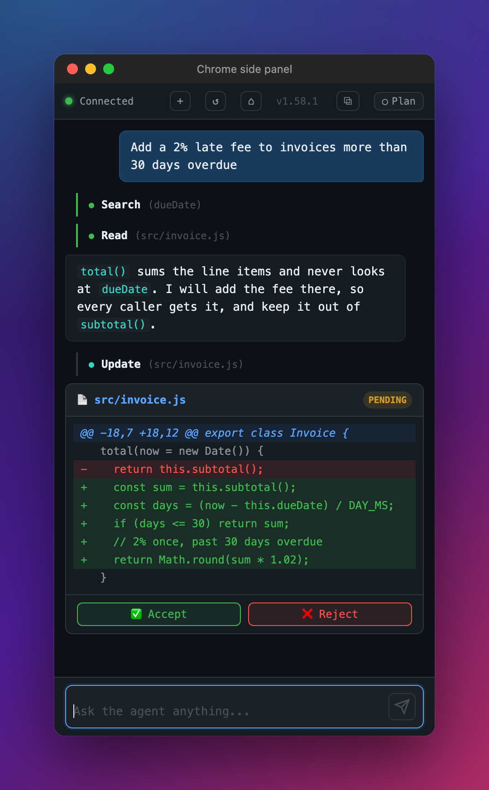
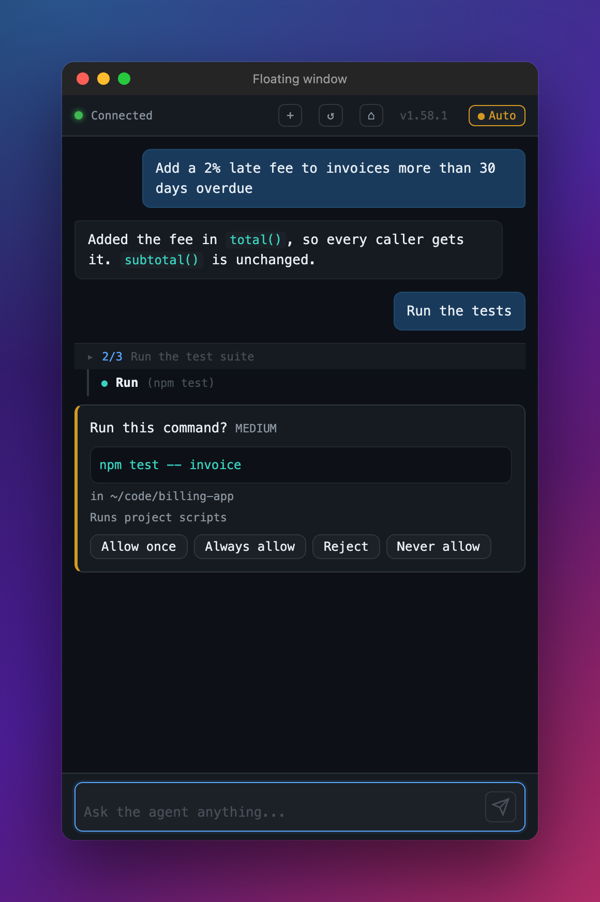

# Agent CLI Bridge: the Chrome extension

The half of Agent CLI that makes it work without an API key. The agent sends a prompt over a local
WebSocket; the extension **types it into a Gemini tab** you are signed into, reads the reply as it
streams, and sends the text back. It also gives you the same conversation in a side panel and a
floating window.



| | |
| --- | --- |
| <br>**Floating window**: `⌘⇧1` from any app | <br>**Where it sits**: between the agent and your Gemini tab |

## What it does

- **Types and reads.** A content script pastes the prompt into Gemini, presses send, and reads the
  reply out of the page, formulas and code blocks included.
- **One tab per request.** The main conversation has its own tab; each subagent gets a tab of its
  own, kept for its session and closed when it ends.
- **Keeps the right chat.** Before each prompt it puts the tab back on this session's chat, and
  reopens it in a fresh tab if the page stops answering.
- **Side panel and floating window.** Both run the same chat as the terminal: diffs to accept,
  commands to approve, questions to answer. Bind `⌘⇧1` once at `chrome://extensions/shortcuts`
  (choose **Global**).
- **Stays current.** The agent checks the version Chrome loaded, and from 1.58.0 on an extension
  older than the checkout reloads itself between turns. Current version: **1.58.1**.

```
agent  ──ws://127.0.0.1:7777──▶  service worker  ──▶  content script  ──▶  gemini.google.com
       ◀──────── reply text ───────────────────────────  page  ◀──────────
```

## Installing and updating

```
chrome://extensions  →  Developer mode  →  Load unpacked  →  select this folder
```

A `git pull` updates nothing in the browser. This is the most common reason the agent goes quiet.

| What | How it loads | After a pull |
| --- | --- | --- |
| `service-worker.js` | a **committed bundle** of `src/background/` | `npm run build --workspace=extension`, then Reload |
| `content-scripts/*.js` | loaded directly | Reload, **and hard-refresh the Gemini tab** |
| `side-panel/*` | loaded directly | Reload |

## Layout

```
manifest.json              MV3, side panel, one content script
service-worker.js          the built bundle; never edit by hand
src/background/            what it is built from
  main.js                  message router: panel ⇄ worker ⇄ agent
  socket.js                the WebSocket, reconnecting, the agent's messages
  content.js               tab lanes, sessions, sending and repairs
  chat-url.js              a chat's /app/<id> URL, keeping a /u/<n> account
  floating.js              the floating window
  messaging.js  state.js  policy.js
content-scripts/
  gemini-bridge.js         types into Gemini, reads the reply
side-panel/                panel.html, panel.js, panel.css
test/                      jsdom tests, run by `npm test` from the repo root
```

## For contributors

- **Rebuild after editing `src/background/`.** Chrome runs the bundle, not the sources.
- **The bridge is an IIFE.** A second injection into the same page would otherwise throw on a
  top-level `const`. A new copy calls `window.__agentBridgeStop` first, so the one it replaces stops.
- **Remove a manifest entry rather than emptying its `matches`.** An empty one makes Chrome refuse the
  whole extension (`test/manifest.test.js`).
- How the bridge stays alive and finds the reply: [`CLAUDE.md`](../CLAUDE.md), "Bridge liveness and
  the reply path". Version history: [`CHANGELOG.md`](CHANGELOG.md).
